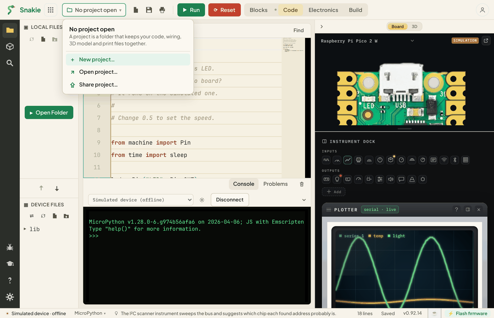
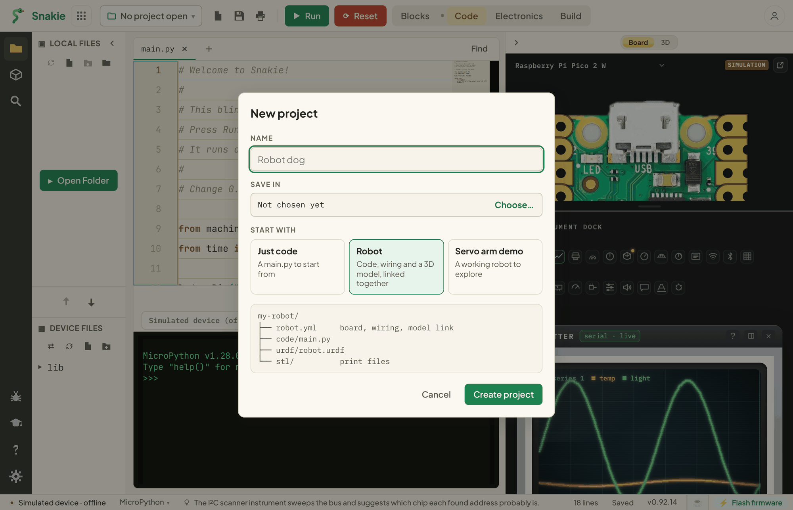
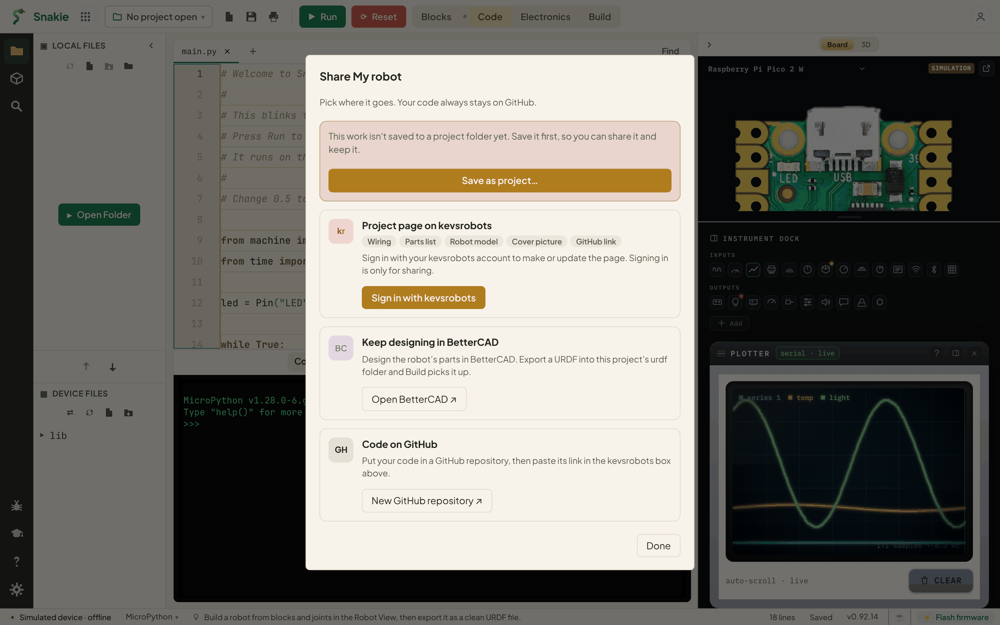

# Start, open and share a project

A **project** is a folder that keeps your code, your wiring, your 3-D robot model and its print files together. Snakie shows the open project's name next to the logo, on every workspace, and that's where you start, open, close and share projects.

## The project menu

Click the project's name in the top bar (it says **No project open** when there isn't one). The menu shows:

- **where the project is saved**, and
- **what's in it**: your code, the Electronics wiring (saved in `robot.yml`), the Build robot model, and print files in the `stl/` folder. Each one jumps to the workspace it belongs to.

Below that are **New project…**, **Open project…**, your **Recent** projects, **Share project…** and **Close project**.

!!! tip "Recent projects work on the web too"
    In the [web app](../get-started/web.md), Recent remembers the folders you've opened, so you can reopen one with a click. Your browser may ask you to allow access to the folder again.

## Work that isn't saved yet

Before you save to a folder, Snakie still keeps your board, parts and wiring for you. The top bar calls this **Untitled robot · not saved**. Its menu offers:

- **Save as project…**, which puts your wiring and any untitled code tabs into a new project folder, or
- **Start fresh**, which clears the unsaved board, parts and wiring so you can begin again. Snakie checks with you first.

## Start a new project

1. Choose **New project…** from the project menu. (In the desktop app, **File ▸ New Project…**, or **Cmd+Shift+N** (**Ctrl+Shift+N** on Windows and Linux), does the same.)
2. Give it a **name**.
3. Under **Save in**, press **Choose…** and pick where the folder goes.
4. Under **Start with**, pick a template:
    - **Just code**: a `main.py` to start from.
    - **Robot**: code, wiring and a 3-D model, linked together, in `code/`, `urdf/` and `stl/` folders.
    - **Servo arm demo**: a working robot to explore.
5. Snakie shows the files it's about to make. Press **Create project**.

## Open and close a project

- **Open project…** picks a project folder from your computer.
- **Recent** lists the projects you've opened lately.
- **Close project** closes the folder. If you have unsaved changes, Snakie asks before closing.

## Share your project

**Share project…** in the project menu opens one sheet for everywhere a project can go:

- **kevsrobots**: puts the project on a [kevsrobots.com](https://www.kevsrobots.com/) project page in one go: the **wiring** diagram, the **parts list**, your **robot model** from Build (with its 3-D parts), and a **cover picture** of the robot. If you don't have a page for it yet, Snakie makes one as a private draft, ready for you to write up. Sending again updates the same page. Visitors see it once you publish the page on kevsrobots.com.
- **BetterCAD**: **Open BetterCAD** to keep designing the robot's parts. Export a URDF from BetterCAD into your project folder and Build picks it up.
- **GitHub**: the link to your code on GitHub. Your code always stays on GitHub; kevsrobots only links to it. See [Save your work with Git](version-control.md).

To send to kevsrobots, sign in with your kevsrobots account when the sheet asks. Signing in is only for sharing.

!!! note "Not saved yet?"
    Sharing works best from a saved project. If your work isn't in a folder yet, the sheet offers **Save as project…** first.

## Where to go next

- [Add and wire up parts](add-and-wire-parts.md)
- [Build a robot in 3-D](robot-view.md)
- [Save your work with Git](version-control.md)
