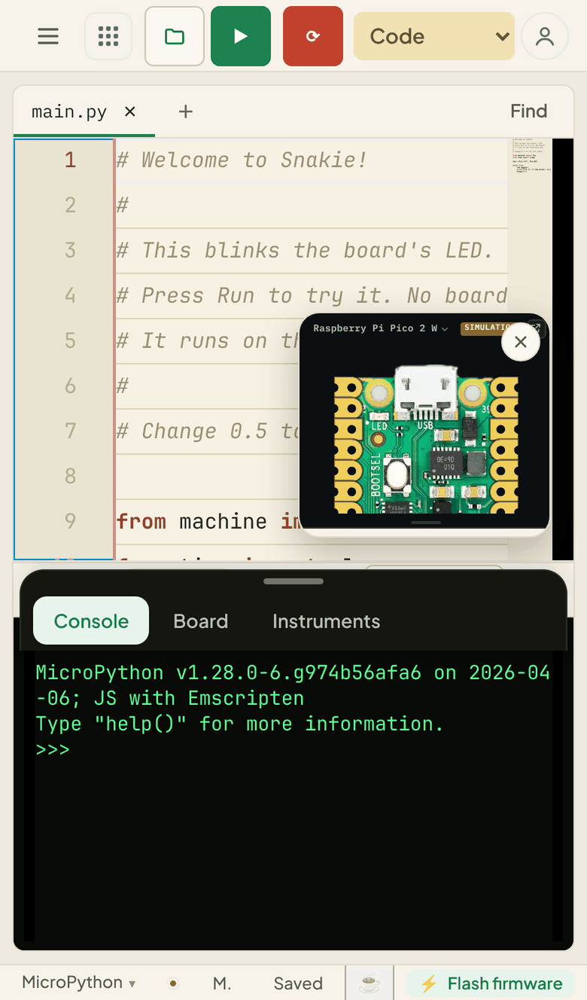

# Use Snakie on a phone or small screen

Snakie fits small laptops, tablets and phones, in the [web app](../get-started/web.md) and the desktop app alike. When the window is narrow, the layout changes so your code, or your robot, gets the screen. This page shows where everything goes.

The full desktop layout is unchanged on a wide screen.

## Below 1100 px wide: laptops and tablets

- **The editor fills the width.** It no longer shares the screen with four columns.
- **Files slides in as a drawer** over the editor. So do Packages, Inspect and the other side panels. Tap outside the drawer to close it.
- **Console, Board and Instruments share one pull-up sheet** under the editor, with a tab for each.
- **A small floating board** peeks over the editor. Tap it to open the sheet's **Board** tab.
- **The workspace tabs** (Code, Blocks, Electronics, Build) become a dropdown.

### Moving the sheet

Drag the sheet's bar up or down and it settles at one of three heights:

1. **Top**, for a long console session or a big board.
2. **Middle**, sharing the screen with your code.
3. **Minimised**, just the grip and the three tab names along the bottom, so the rest of the screen is code.

Tapping the grip steps through the same three heights. On a minimised sheet, tap a tab name to open it.

## 640 px and below: phones

{ width="320" }

On a phone, Snakie goes a step further:

- The activity bar folds into the **☰** menu.
- **Run** and **Reset** shrink to icons.
- The status bar puts the **MicroPython / CircuitPython** switch first.
- A phone held sideways gets the same phone layout, so the workspace doesn't shrink to a strip.

## Electronics on a phone

The board gets the screen.

- **Sync**, **ERC**, **Live** and **Help** sit in one row at the top.
- The parts **Library** and the project **Browser** rise from the bottom as sheets (side panels in landscape). Open them with the **Library** button and the **☰** button. Both start closed.
- Adding a part closes the Library, so you can see what you added.
- The board tools are a dock across the bottom, with undo and redo on the left. A selected part's tools dock on top of that bar, always in the same place.

See [Add and wire up parts](add-and-wire-parts.md) for what the tools do.

## Build on a phone

- The tool bar is one scrolling row of finger-sized buttons.
- The hierarchy panel and a part's properties are sheets that rise from the bottom (side panels in landscape).
- The ViewCube is smaller, with **Home** and the projection switch always beside it.
- A phone opens on **Grab**: a finger on a part poses it, and a finger on empty space orbits the view.
- **Press and hold a part** to open its menu: **Rename**, **Make base**, **Delete** and its joint. (With a mouse, right-click does the same.)

Animate works on a phone too. See [Bind servos and animate](motion-studio.md).

!!! tip "Saving space on an iPad"
    If you use Snakie on an iPad, add it to your Home Screen so it opens full screen. See [Use Snakie on an iPad or Chromebook](ipad-chromebook.md).

## Where to go next

- [Snakie in your browser](../get-started/web.md): everything about the web app.
- [Your first steps](../get-started/first-steps.md): a tour of the Snakie window.
